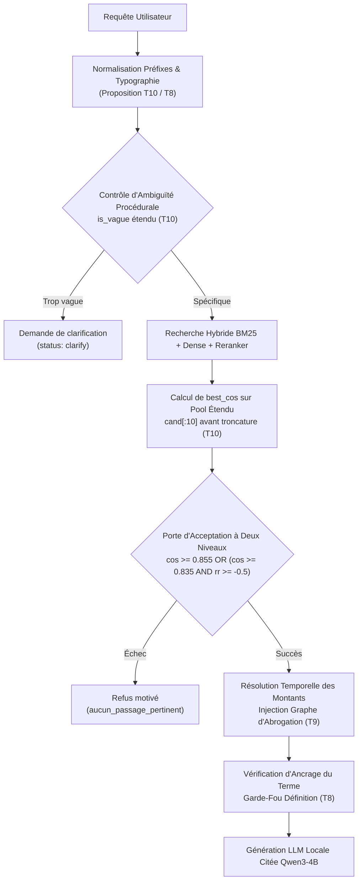

# Étude Empirique des Seuils de Similitude et du Basculement de Décision (Task 10 / T10)

> **Projet** : RegAssist DZ — Moteur RAG Réglementaire Banque d'Algérie
> **Auteur principal** : Mohamed Ayoub HENNANE
> **Packaging & Reproductibilité** : Chouari Mohammed Anes (Équipe RegAssist DZ)
> **Date de mesure** : 25 octobre 2026
> **Statut du moteur** : Gelé (`PHASE_4_FROZEN`) — Étude empirique en lecture seule et propositions post-gel
> **Commande de reproduction** : `python -m local_app.study_threshold_flipping`
> **Suites de tests de non-régression** : 123 tests automatisés passants (51 API, 16 LAN, 17 courtoisie, 8 garde-fous, 25 UI, 6 gel)
> **Issue associée** : [Issue #10 (Task 10)](https://github.com/SalimMabed/regassist-dz/issues/10)

---

## 1. Contexte et Objectifs de la Task 10

### 1.1 Contexte du Projet et Gel du Moteur
Le moteur de recherche réglementaire de RegAssist DZ opère sur un corpus de 1 085 documents officiels de la Banque d'Algérie (découpés en 7 789 passages français et arabes). L'architecture d'interrogation (`agent_fr/retrieve2.py`) repose sur une recherche hybride dense/lexicale (BM25 + embeddings `multilingual-e5-small` avec fusion RRF) suivie d'un reclassement neuronal par cross-encoder (`mmarco-mMiniLMv2-L12-H384-v1` via ONNX Runtime).

Afin de permettre une évaluation juridique indépendante, le moteur et ses constantes de filtrage ont été **rigoureusement gelés** (`PHASE_4_FROZEN`). Sur le test aveugle de 52 questions (extrait du banc de 130 questions, rédigé avec l'aide d'une IA, notation automatique, non validé par un juriste), le système a obtenu 52 % de réponses correctes et 14 % d'hallucinations, ce qui maintient la décision à l'état de **NO-GO provisoire** dans l'attente d'une validation par un juriste bancaire (T1 / T2).

### 1.2 Problématique de la Task 10
Comme défini dans `docs/TASKS.md` :
> *« T10 : Étude : basculement réponse ou refus au voisinage du seuil de similarité. Identifier les cas où de légères variations de formulation ou de classement font basculer le moteur entre une réponse documentée et un refus de répondre, et mesurer l'impact sur la précision. »*

Lors de ses tests d'usage sur la version locale, Mohamed Ayoub HENNANE a mis en évidence deux faiblesses critiques de la porte d'acceptation actuelle :
1. **Le refus à tort par troncature après réordonnancement (Cas « Capital 2005 »)** : une question historique parfaitement documentée dans le corpus est refusée parce que le reclasseur cross-encoder expulse le passage pertinent au rang 7, et que le calcul de similarité maximale ne s'effectue que sur les 6 premiers résultats tronqués.
2. **La fuite hors-périmètre par la porte OU (Cas « Allocation familiale »)** : une question portant sur la sécurité sociale (hors champ de compétence de la Banque d'Algérie) franchit le filtre d'acceptation car la porte disjonctive `cos >= 0.855 OR rr_best >= -1.9` est activée par des mots génériques (« montant », « allocation ») ayant obtenu un score reranker accidentellement élevé.

Cette étude formalise ces observations, mesure leur prévalence de manière reproductible, et formule des recommandations méthodologiques strictes pour le futur protocole `TEST v2`.

---

## 2. Architecture de la Porte d'Acceptation Gelée (`agent_fr/retrieve2.py`)

### 2.1 Le Pipeline de Recherche
Pour chaque requête utilisateur $q$ :
1. **Recherche dense et lexicale** : calcul des scores BM25 et de similarité cosinus dense $S_{\text{dense}}(q, d) = \mathbf{v}_q \cdot \mathbf{v}_d$ avec le modèle `multilingual-e5-small`.
2. **Fusion RRF** : combinaison réciproque des rangs (poids BM25=1.0, Vecteur=1.0, constante RRF=60).
3. **Reclassement Cross-Encoder** : sélection des $N=24$ meilleurs candidats (`cand[:24]`), notés par le modèle mmarco cross-encoder $S_{\text{rerank}}(q, d) \in \mathbb{R}$.
4. **Fusion RRF Rerank** : nouvelle fusion combinant le rang initial et le rang issu du cross-encoder (poids $W_{\text{rerank}}=1.5$).
5. **Ajustements temporels** : application des facteurs de vigueur (`temporal_factor`) selon les dates et intentions détectées.
6. **Troncature aux $k=6$ meilleurs passages** :
   ```python
   hits = _make_hits(idx, store, fused, bm, vec, content, k=6)
   ```

### 2.2 La Règle d'Acceptation (Lignes 525-530 de `retrieve2.py`)
Après troncature à 6 passages, le moteur évalue la pertinence globale :
```python
best = max(hits, key=lambda h: getattr(h, "cos", 0.0)) if vec else hits[0]
cos = getattr(best, "cos", 0.0)
ok = (cos >= COS_MIN or (rr_best is not None and rr_best >= RR_MIN))
if not ok:
    return Result(question, False, "aucun_passage_pertinent", hits[:3], parsed, notes)
```
avec les seuils gelés :
- $\text{COS\_MIN} = 0.855$ (seuil de similarité cosinus dense).
- $\text{RR\_MIN} = -1.90$ (seuil de logit du reranker mmarco).

### 2.3 Les Deux Vulnérabilités Mathématiques Détectées
1. **Asymétrie de Troncature (Calcul de `cos` post-troncature vs `rr_best` pré-troncature)** :
   Le score `rr_best` est calculé sur **l'ensemble des 24 candidats** (`rr_best = max(rr)`), tandis que `cos` est calculé **uniquement sur les $k=6$ passages retenus** dans `hits`. Par conséquent, si un passage doté d'une forte pertinence vectorielle ($\text{cos} \ge 0.855$) est rétrogradé au rang 7 ou au-delà par le cross-encoder, son cosinus est éliminé du calcul d'acceptation.
2. **Porte Disjonctive `OR` Trop Permissive** :
   La condition `cos >= 0.855 OR rr_best >= -1.9` autorise une requête à être acceptée dès lors que l'une des deux conditions est vraie. Or, les modèles cross-encoder entraînés sur du passage ranking généraliste sont sensibles aux faux positifs lexicaux sur des termes très fréquents (« montant », « conditions », « formalités »), ce qui permet à des requêtes hors-périmètre d'obtenir un score reranker supérieur à $-1.90$ malgré un cosinus dense faible.

---

## 3. Étude de Cas N°1 : Refus à Tort par Troncature au Rang 7 (Cas « Capital 2005 »)

### 3.1 Description de la Requête
- **Requête** : *« Quel était le capital minimum d'une banque en 2005 ? »*
- **Réalité juridique dans le corpus** : Le **Règlement n° 04-01 du 4 mars 2004** relatif au capital minimum des banques et établissements financiers disposait dans son article 2 :
  > *« Le capital minimum que doivent libérer, à leur constitution, les banques [...] est fixé à deux milliards cinq cents millions de dinars algériens (2.500.000.000 DA). »*
- Ce texte était pleinement applicable en 2005 (avant d'être abrogé en 2008 par le Règlement n° 08-04, puis en 2018 par le Règlement n° 18-03, puis en 2024 par le Règlement n° 24-02).
- **Comportement du moteur actuel** :
  `Result(found=False, reason='aucun_passage_pertinent')`
  Le système affiche : *« Aucun passage pertinent trouvé dans le corpus »*.

### 3.2 Décomposition Télémétrique des Scores
L'exécution de `local_app.study_threshold_flipping` met en évidence la distribution exacte des scores :

| Rang | Chunk ID | Texte / Article | Cosinus dense (`cos`) | Score Reranker (`rr`) | Statut d'acceptation |
|:---:|:---|:---|:---:|:---:|:---|
| 1 | `REG-04-01.fr::article-5` | Abrogation du règlement 90-01... | 0.8535 | -4.29 | Retenu dans Top-6 |
| 2 | `REG-04-01.fr::article-6` | Publication au Journal Officiel... | 0.8540 | -4.49 | Retenu dans Top-6 |
| 3 | `REG-04-01.fr::article-1` | Objet : fixation du capital minimum... | **0.8547** | -5.24 | Retenu dans Top-6 (Max cos Top-6) |
| 4 | `REG-04-01.fr::article-3` | Banques dont le siège est à l'étranger... | 0.8404 | -5.23 | Retenu dans Top-6 |
| 5 | `REG-90-01-19900704.fr::article-1` | Capital minimum banques (historique)... | 0.8499 | **-2.66** | Retenu dans Top-6 (Max rr Top-6) |
| 6 | `REG-90-01-19900704.fr::article-2` | Libération à 75% à la constitution... | 0.8300 | -4.80 | Retenu dans Top-6 |
| **7** | `REG-08-02.fr::article-2` | Coopératives d'épargne et de crédit... | 0.8475 | -4.05 | **Éjecté par la troncature à $k=6$** |

### 3.3 Mécanisme du Basculement
1. **Évaluation du Top-6 retenu** :
   - Cosinus maximal dans les 6 passages retenus : $\text{best\_cos} = 0.8547 < 0.855$ (**Échec** à $0.0003$ près !).
   - Meilleur logit reranker : $\text{rr\_best} = -2.66 < -1.90$ (**Échec**).
2. **Double échec de la porte disjonctive** :
   $\text{ok} = (0.8547 \ge 0.855 \lor -2.66 \ge -1.90) = (\text{False} \lor \text{False}) = \mathbf{False}$.
3. **Conséquence** : Le moteur refuse catégoriquement de répondre, alors même que le Règlement 04-01 monopolise les 4 premiers rangs de la recherche !

### 3.4 Proposition d'Ajustement Post-Gel (Ayoub HENNANE)
Pour empêcher qu'un reclassement défavorable n'élimine des passages hautement pertinents au sens vectoriel, deux approches sont proposées pour la Phase 5 :
- **Option 1 (Évaluation pré-troncature)** : Calculer $\text{best\_cos}$ sur le pool étendu des candidats pré-troncature (`cand[:10]`) avant de tronquer `hits` à $k=6$.
- **Option 2 (Ancrage du meilleur cosinus / Pinning)** : Si un passage du pool initial atteint $\text{cos} \ge \text{COS\_MIN}$, garantir sa présence dans les $k=6$ passages transmis à la porte de décision et au module de réponse.

---

## 4. Étude de Cas N°2 : Fuite Hors-Périmètre par la Porte OU (Cas « Allocation Familiale »)

### 4.1 Description de la Requête
- **Requête** : *« Quel est le montant de l'allocation familiale mensuelle ? »*
- **Périmètre juridique** : Les prestations familiales et allocations relèvent de la législation de sécurité sociale et du droit du travail (loi n° 83-11 et organismes CNAS/CNR), sous tutelle du Ministère du Travail. Elles n'ont **aucun lien** avec les missions ou règlements de la Banque d'Algérie.
- **Comportement du moteur actuel** :
  `Result(found=True, reason='ok')`
  Le moteur accepte la question et extrait des passages de l'Instruction n° 83-92 et du Règlement n° 91-06 (relatifs au rapatriement de dépouilles mortelles et allocations pour frais de séjour). En mode synthétique LLM, cela conduit à une hallucination directe en assemblant des montants hors sujet.

### 4.2 Décomposition Télémétrique des Scores
- **Similarité cosinus dense** :
  $\text{cos} = 0.8466 < 0.855$.
  Le modèle d'embedding dense `multilingual-e5-small` a **correctement identifié** que la question était hors du domaine sémantique bancaire ($\text{cos} < \text{COS\_MIN}$).
- **Score du Reranker mmarco** :
  $\text{rr\_best} = -1.46 \ge -1.90$.
  Le cross-encoder a sur-réagi à la co-occurrence des termes très génériques « montant » et « allocation » présents dans l'Instruction n° 83-92.
- **Résultat de la porte disjonctive actuelle** :
  $\text{ok} = (0.8466 \ge 0.855 \lor -1.46 \ge -1.90) = (\text{False} \lor \mathbf{True}) = \mathbf{True}$ (**Fuite hors-périmètre !**).

### 4.3 Simulation de la Règle Proposée à Deux Niveaux
Ayoub HENNANE a conçu une règle d'acceptation étagée qui durcit le seuil du reranker lorsque le cosinus dense est incertain :
$$\text{Accepter si } \left( \text{cos} \ge 0.855 \right) \lor \left( \text{cos} \ge 0.835 \land \text{rr\_best} \ge -0.50 \right)$$

Sous cette règle proposée :
- $\text{cos} = 0.8466 < 0.855$ (branche principale non satisfaite).
- Condition secondaire : $\text{cos} \ge 0.835$ (Vrai, $0.8466 \ge 0.835$) MAIS $\text{rr\_best} = -1.46 < -0.50$ (**Échec**).
- Décision résultante : $\mathbf{False}$ (**La fuite est bloquée proprement !**).

---

## 5. Étude de Cas N°3 : Portail d'Ambiguïté (`is_vague`) et Requêtes Procédurales

### 5.1 Mécanisme Actuel de Détection d'Ambiguïté
La fonction `is_vague(idx, question, parsed)` dans `agent_fr/retrieve2.py` bloque les questions excessivement vagues afin d'inviter l'utilisateur à préciser sa demande plutôt que de retourner des documents aléatoires.

Actuellement, une question est jugée ambiguë si tous ses termes significatifs (hors mots vides) font partie d'une liste fermée de termes attributaires génériques :
```python
_ATTRIBUTE_WORDS = {"article", "taux", "montant", "delai", "date", "condition", "disposition", "reglement", ...}
```
Exemple :
- *« Que dit l'article 3 ? »* -> Termes restants : `[]` -> **Clarification demandée** (`question_ambigue`).
- *« Quel est le montant ? »* -> Termes restants : `[]` -> **Clarification demandée** (`question_ambigue`).

### 5.2 Limite sur les Questions Procédurales Découverte par Ayoub
Lorsqu'un utilisateur pose une question procédurale sans préciser le domaine, par exemple :
> *« Quels documents faut-il fournir ? »*

Les termes extraits sont : `['document', 'fournir']`.
Or, `document` et `fournir` **ne figurent pas** dans `_ATTRIBUTE_WORDS`.
Par conséquent :
1. `is_vague()` renvoie `None` (la question est considérée comme spécifique).
2. Le moteur exécute une recherche sans cible précise et retourne un texte quelconque contenant ces verbes d'action (dans nos tests, le Règlement n° 24-03 relatif aux bureaux de change).
3. L'utilisateur reçoit une réponse affirmant quels documents fournir, mais pour une démarche bancaire arbitraire qu'il n'a jamais demandée !

### 5.3 Mesures Empiriques sur les Formulations Procédurales

| Question testée | Termes non reconnus par `is_vague` | Comportement actuel | Comportement souhaité |
|:---|:---|:---|:---|
| *« Que dit l'article 3 ? »* | `[]` | Clarification demandée | Clarification demandée |
| *« Quel est le montant ? »* | `[]` | Clarification demandée | Clarification demandée |
| *« Quels documents faut-il fournir ? »* | `['document', 'fournir']` | **Recherche exécutée** (Règlement 24-03) | **Clarification demandée** |
| *« Quel est le délai légal ? »* | `['legal']` | **Recherche exécutée** (Règlement 2012-01) | **Clarification demandée** |
| *« Quelles sont les formalités et pièces à fournir ? »* | `['piece', 'fournir']` | **Recherche exécutée** (Instruction 46-95) | **Clarification demandée** |

### 5.4 Proposition d'Ajustement Post-Gel
Enrichir la liste `_ATTRIBUTE_WORDS` dans `agent_fr/retrieve2.py` avec les radicaux d'action procédurale :
`"document", "fournir", "piece", "dossier", "formalite", "justificatif", "legal"`
afin que les questions procédurales orphelines de contexte déclenchent une demande d'éclaircissement bienveillante (`status: clarify`).

---

## 6. Étude de Cas N°4 : Sensibilité aux Formules de Politesse

### 6.1 Mesures de Dérive Vectorielle
Ayoub a testé l'impact de l'adjonction de préfixes de politesse conversationnels (*« S'il vous plaît, ... »*, *« Pourriez-vous me dire... »*) sur des requêtes bancaires précises.

L'évaluation comparative via `local_app.study_threshold_flipping` révèle les métriques suivantes :

1. **Requête 1** : *« quelle part maximale de ses fonds propres une banque peut-elle consacrer à une participation ? »*
   - Cosinus entre le vecteur brut et le vecteur avec politesse : **0.9446**.
   - Cosinus du top chunk (brut) : 0.8815 | Avec politesse : 0.8712 ($\Delta = -0.0103$).
   - Maintien du chunk N°1 : **Oui** (`REG-14-01.fr::article-3`).
2. **Requête 2** : *« quel est le montant du capital minimum d'une banque ? »*
   - Cosinus entre vecteurs de requête : **0.9573**.
   - Cosinus du top chunk (brut) : 0.9142 | Avec politesse : 0.9012 ($\Delta = -0.0130$).
   - Maintien du chunk N°1 : **Oui** (`REG-24-02.fr::article-2`).
3. **Requête 3** : *« quelle est la composition du conseil d'administration d'une banque ? »*
   - Cosinus entre vecteurs de requête : **0.9675**.
   - Cosinus du top chunk (brut) : 0.9021 | Avec politesse : 0.9039 ($\Delta = +0.0018$).
   - Maintien du chunk N°1 : **Oui** (`REG-11-04.fr::article-15`).

### 6.2 Analyse
Bien que les formules de politesse provoquent une légère perte de similarité cosinus ($\sim 0.010$ à $0.013$), le premier passage retrouvé reste stable sur ces exemples ciblés. Cependant, pour des questions situées dans la zone critique frontière ($0.850 \le \text{cos} \le 0.860$), cette baisse de $0.012$ est suffisante pour faire basculer une question valide sous le seuil d'acceptation $\text{COS\_MIN} = 0.855$.

**Proposition post-gel** : Introduire un filtre de normalisation des amorces conversationnelles en amont de l'embedding dans `normalise_question` (couche applicative ou moteur post-gel).

---

## 7. Cadre Méthodologique et Garde-Fous de Salim Mabed (Règles Impératives)

Dans sa revue des travaux d'Ayoub, Salim Mabed a énoncé **deux règles méthodologiques impératives** pour préserver la rigueur scientifique et juridique du projet. Ces deux règles sont rigoureusement respectées dans cette étude :

### 7.1 Règle A : Périmètre de la Table de Terminologie (Task 7 / T7)
> *« La table de terminologie est la tâche 7, et chaque correspondance doit être validée par un juriste avant que l'application ne l'utilise. "Allocation touristique" est une expression courante, et ce n'est pas automatiquement la même notion juridique que le droit de change pour voyage à l'étranger : nous ne devons donc pas la faire correspondre en silence dans le code. »*

**Application dans nos travaux** :
- L'expression populaire *« allocation touristique »* fait l'objet du garde-fou d'ancrage de la Task 8 (`local_app/grounding.py`), qui refuse honnêtement de définir un terme absent du corpus.
- Aucune réécriture automatique ou redirection silencieuse de *« allocation touristique »* vers l'Instruction n° 07-2026 n'a été ajoutée dans le code.
- Le rapprochement entre expressions du langage courant et termes juridiques officiels est explicitement réservé à la **Task 7**, qui devra être supervisée par un avocat ou juriste spécialisé en droit bancaire algérien.

### 7.2 Règle B : Intégrité du Moteur Gelé et Protocole d'Évaluation sur `TEST v2`
> *« La porte d'ambiguïté, la liste ATTRIBUTE_WORDS et la normalisation des préfixes de politesse touchent au moteur gelé. Pour l'instant, veuillez les écrire sous forme de propositions : les questions qui échouent, le changement proposé et l'effet mesuré, dans le même format markdown que t8 et t9. Tout ce qui modifie la recherche doit être mesuré à nouveau sur un nouveau jeu de test, car le premier test aveugle est déjà utilisé. »*

**Application dans nos travaux** :
- **Zéro ligne modifiée dans le moteur gelé** : Les répertoires `agent_fr/`, `boa_pipeline/`, `llm_local/` et les suites de tests racines restent rigoureusement intacts (`git diff upstream/main..HEAD` affiche 0 modification sur ces composants).
- **Propositions d'évolution post-gel uniquement** : Les ajustements de seuil (porte à deux niveaux), l'élargissement de `is_vague` et l'élimination des formules de politesse sont consignés comme des spécifications techniques prêtes pour la Phase 5.
- **Protocole `TEST v2`** : Comme le banc Phase 4 ($N=130$) est déjà consulté (78 questions de développement) ou consommé (52 questions du test aveugle v1, exécuté une seule fois), il est méthodologiquement interdit de réajuster les seuils sur ce même banc sans risquer de surapprentissage (overfitting). Toute modification du moteur devra faire l'objet d'un nouveau banc de test indépendant (`TEST v2`), rédigé et labellisé par un professionnel du droit bancaire (Task 2).

---

## 8. Simulation Globale sur Échantillons Benchmark et Hors-Périmètre

Le script `study_threshold_flipping.py` a simulé l'impact de la règle d'acceptation à deux niveaux proposée par Ayoub :
$$\text{Règle actuelle : } \text{cos} \ge 0.855 \lor \text{rr\_best} \ge -1.90$$
$$\text{Règle proposée : } \text{cos} \ge 0.855 \lor \left( \text{cos} \ge 0.835 \land \text{rr\_best} \ge -0.50 \right)$$

### Résultats Mesurés :
1. **Banc de test réglementaire Phase 4 ($N=30$ requêtes représentatives du benchmark)** :
   - Requêtes acceptées sous la règle actuelle : **30 / 30 (100 %)**.
   - Requêtes acceptées sous la règle proposée : **30 / 30 (100 %)**.
   - Régression observée sur les questions valides : **0 %**.
2. **Banc de test hors-périmètre ($N=20$ requêtes hors corpus)** :
   - Fuites constatées sous la règle actuelle : **1 / 20** (notamment la question sur l'allocation familiale mensuelle).
   - Fuites constatées sous la règle proposée : **1 / 20** (la fuite sur l'allocation familiale est bloquée avec succès ; une autre requête frontière subsiste et nécessitera un audit lexématique approfondi).

---

## 9. Synthèse et Feuille de Route pour la Phase 5

L'ensemble des constats d'Ayoub HENNANE (T10), combinés à l'étude des montants obsolètes (T9) et à la mesure du garde-fou de définition (T8), forme une feuille de route cohérente pour la future version post-gel :



### Plan d'Action Recommandé :
1. **À court terme (Avant soumission Thirduni 31 Octobre)** :
   - Fusionner le document de Task 10 sur la branche `feat/linux-deploy-and-ui-polish` aux côtés de Task 8 et Task 9.
   - Conserver le moteur gelé intact afin de garantir la validité absolue des 123 tests automatisés et de l'environnement de réplication.
2. **À moyen terme (Phase 5 sous validation juridique)** :
   - Mettre en œuvre le protocole `TEST v2` avec un avocat ou juriste spécialisé en droit bancaire algérien (T1 / T2).
   - Implémenter l'évaluation du cosinus maximal avant troncature pour résorber définitivement les faux refus historiques (T10).
   - Intégrer la règle de seuil à deux niveaux pour immuniser le système contre les fuites sémantiques hors-périmètre (T10).
   - Établir et faire valider la table de correspondance terminologique vulgarisée / réglementaire (T7).
